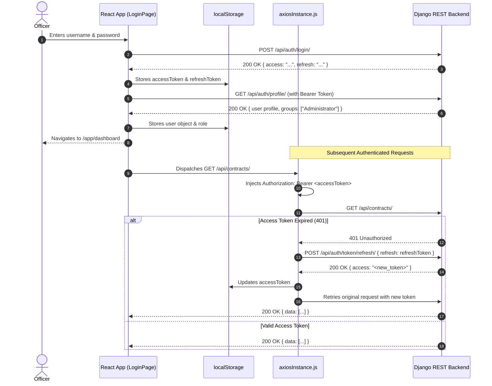

# ContractCommand — Frontend System Architecture & Engineering Document

**Project:** P07 – ContractCommand  
**Project Title:** Defence Contract and Procurement Management Platform  
**Academic Context:** MCA 2nd Year — HCLTech Career Shaper  
**Institution:** ABES Engineering College  
**Architecture Pattern:** Component-Driven Single Page Application (SPA) with Role-Based Access Control (RBAC)  

---

## 1. Architectural Principles

The ContractCommand frontend was architected according to five core engineering principles:

1. **Strict Frontend/Backend Separation:** The React frontend runs independently of the Django REST Framework backend, communicating solely over standardized REST API protocols.
2. **Defence-Sector Design Language:** Visual identity inspired by DCMA (Defence Contract Management Agency) and the Ministry of Defence (MoD, India), featuring a Navy Blue (`#102A43`), Saffron (`#E58A24`), and Emerald Green (`#287A4B`) palette with high-contrast accessibility.
3. **Role-Gated Security Architecture:** Client-side access is strictly coordinated through JWT authentication, route guards (`ProtectedRoute`, `RoleGuard`), and UI permission checks (`canWrite()`, `canDelete()`, `hasRole()`).
4. **Predictable State & Resilience:** Centralized authentication context paired with declarative custom hooks (`useDebounce`, `useFetch`) ensures minimal re-renders and zero memory leaks.
5. **Rigorous Compliance with Backend Contracts:** Direct alignment with backend serializers, envelope wrappers, validation regexes (`CC-YYYY-NNNN`, `INV-YYYY-NNNNN`), and statutory 18% GST computations.

---

## 2. Technology Stack

```text
┌─────────────────────────────────────────────────────────────┐
│                      FRONTEND STACK                         │
├──────────────────────────┬──────────────────────────────────┤
│ Core Framework           │ React 18.3.1                     │
│ Build Tool & Dev Server  │ Vite 6.0+ (ESBuild + Rollup)     │
│ Client-Side Routing      │ React Router DOM v6.28.0         │
│ HTTP Client              │ Axios v1.7.9                     │
│ Design & UI Components   │ Bootstrap 5.3.3 + Bootstrap Icons│
│ Visual Analytics         │ Chart.js 4.4.7 + react-chartjs-2 │
│ Form Management          │ React Hook Form + Yup            │
│ Modern Vector Icons      │ Lucide React v0.468.0            │
│ Testing Framework        │ Vitest 5.1.1 + Testing Library   │
│ Code Quality & Linting   │ Oxlint 0.15.0                    │
└──────────────────────────┴──────────────────────────────────┘
```

---

## 3. Directory & File Organization

```text
frontend/src/
│
├── api/                       # API Services Layer (Axios)
│   ├── axiosInstance.js       # Centralized HTTP client + JWT interceptor
│   ├── authApi.js             # Authentication, profile, password APIs
│   ├── contractApi.js         # Contract CRUD & document metadata APIs
│   ├── procurementApi.js      # Master plans, requisitions, item lines APIs
│   ├── vendorApi.js           # Vendor directory & 4-pillar evaluation APIs
│   ├── financeApi.js          # Invoices, line items, payment disbursements APIs
│   └── dashboardApi.js        # Strategic command aggregated analytics
│
├── context/                   # Global State Layer
│   └── AuthContext.jsx        # JWT session, user profile, role helper methods
│
├── hooks/                     # Custom React Hooks
│   ├── useAuth.js             # Hook consumer for AuthContext
│   ├── useDebounce.js         # Debounce hook for responsive search inputs
│   └── useFetch.js            # Generic async query & cache hook
│
├── layouts/                   # Shell & Navigation Layouts
│   ├── PublicLayout.jsx       # Public website shell with Defence Header & Footer
│   └── AppLayout.jsx          # Protected app shell with responsive sidebar & topbar
│
├── routes/                    # Routing & Security Guards
│   ├── AppRoutes.jsx          # Complete application route map
│   ├── ProtectedRoute.jsx     # Unauthenticated redirector to /login
│   └── RoleGuard.jsx          # Role-based route authorization barrier
│
├── components/                # Reusable UI Component Library
│   ├── common/
│   │   ├── Navbar.jsx         # Public top navigation
│   │   ├── Footer.jsx         # Official defence disclaimer footer
│   │   ├── Sidebar.jsx        # Dashboard sidebar with active route highlights
│   │   ├── Topbar.jsx         # Operational header with user role & logout
│   │   ├── LoadingSpinner.jsx # Standardized loading indicator
│   │   ├── StatusBadge.jsx    # Status pill badge (Active, Draft, Approved, etc.)
│   │   ├── PriorityBadge.jsx  # Priority pill badge (Urgent, High, Medium, Low)
│   │   ├── EmptyState.jsx     # Clean empty ledger fallback view
│   │   └── ConfirmDialog.jsx  # Modal dialog for high-risk actions (delete)
│   └── ...
│
├── pages/                     # Routed View Controllers
│   ├── public/                # Landing, About, Modules, Announcements, Contact
│   ├── auth/                  # LoginPage, ProfilePage
│   ├── dashboard/             # DashboardPage (Strategic Command)
│   ├── contracts/             # List, Create, Details, Edit
│   ├── procurement/           # Plans (List, Create, Details, Edit), Requisitions
│   ├── vendors/               # List, Create, Details, Edit, Evaluate, Compare
│   ├── finance/               # Invoices (List, Create, Details), Payments
│   └── errors/                # NotFoundPage (404), UnauthorizedPage (403)
│
├── utils/                     # Formatting & Helpers
│   ├── formatters.js          # INR currency (₹), Indian dates, number formats
│   └── roleHelpers.js         # Security classification & role verification
│
├── test/                      # Vitest Automated Test Suites (9 Suites, 77 Tests)
│   ├── setup.js               # JSDOM Canvas & Jest-DOM environment configuration
│   ├── foundation.test.jsx
│   ├── publicPages.test.jsx
│   ├── authLayout.test.jsx
│   ├── contracts.test.jsx
│   ├── procurement.test.jsx
│   ├── vendors.test.jsx
│   ├── finance.test.jsx
│   ├── dashboard.test.jsx
│   └── integration.test.jsx
│
├── App.jsx                    # Root component with Toast / Context providers
└── main.jsx                   # React 18 DOM mount point
```

---

## 4. Authentication & JWT Interceptor Flow



---

## 5. Security & Role-Based Access Control (RBAC)

Access control operates across three complementary layers:

1. **Routing Layer (`RoleGuard.jsx`):**
   - Intercepts unauthorized navigation at the router level.
   - Evaluates `allowedRoles.some(r => user.groups.includes(r))` or `user.is_superuser`.
   - Unauthorized attempts immediately redirect to `/unauthorized` (HTTP 403 status view).
2. **Component & Action Layer (`useAuth` Hook):**
   - `canWrite()`: Evaluates whether the user holds `Administrator` or `Contracts Manager` credentials.
   - `canDelete()`: Evaluates whether the user holds `Administrator` clearance.
   - Restricts deletion buttons, approval controls, and creation forms from read-only officers (`Safety Officer`).
3. **Backend Enforcement:**
   - Django REST Framework viewsets enforce `IsAuthenticated`, `IsAdminOrContractsManager`, and `IsAdministrator` independently of client state.

---

## 6. Financial Accuracy & 18% GST Engine

To guarantee strict compliance with Indian Defence Financial Regulations (DFR 2024):
- **Line Items Subtotal:** $\text{Subtotal} = \sum_{i=1}^{n} (\text{quantity}_i \times \text{unit\_price}_i)$
- **Statutory 18% GST:** $\text{Tax Amount} = \text{round}\left(\frac{\text{Subtotal} \times 18.00}{100}, 2\right)$
- **Grand Milestone Total:** $\text{Total Amount} = \text{Subtotal} + \text{Tax Amount}$
- **Balance Outstanding:** $\text{Balance} = \text{Total Amount} - \sum \text{Completed Payments}$

All currency values are formatted for official Indian government ledgers using `Intl.NumberFormat('en-IN', { style: 'currency', currency: 'INR' })`.
